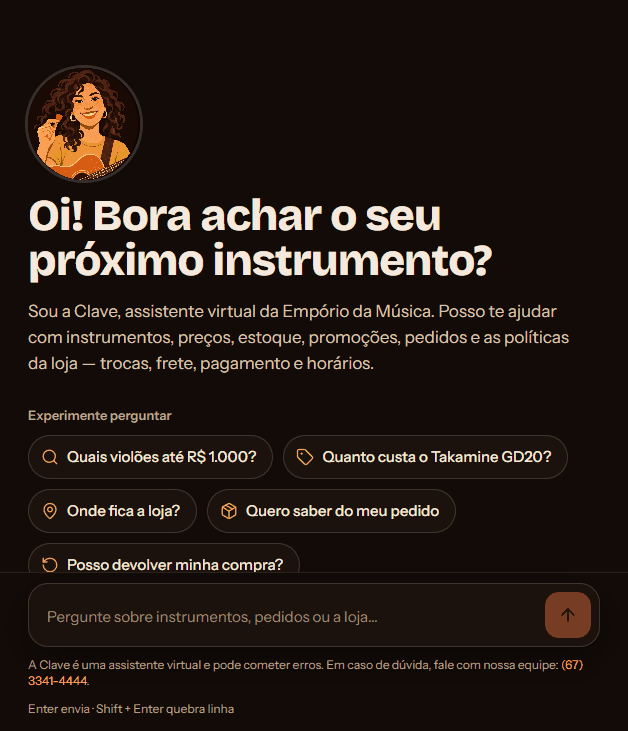
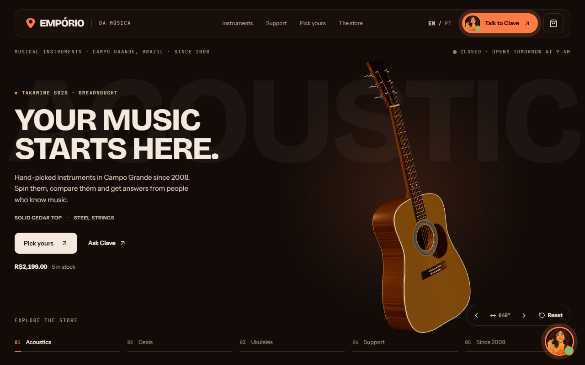
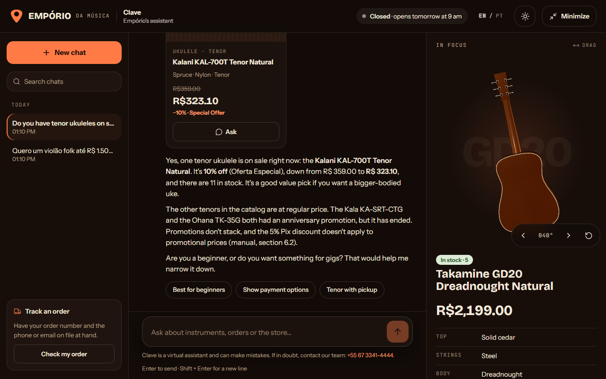
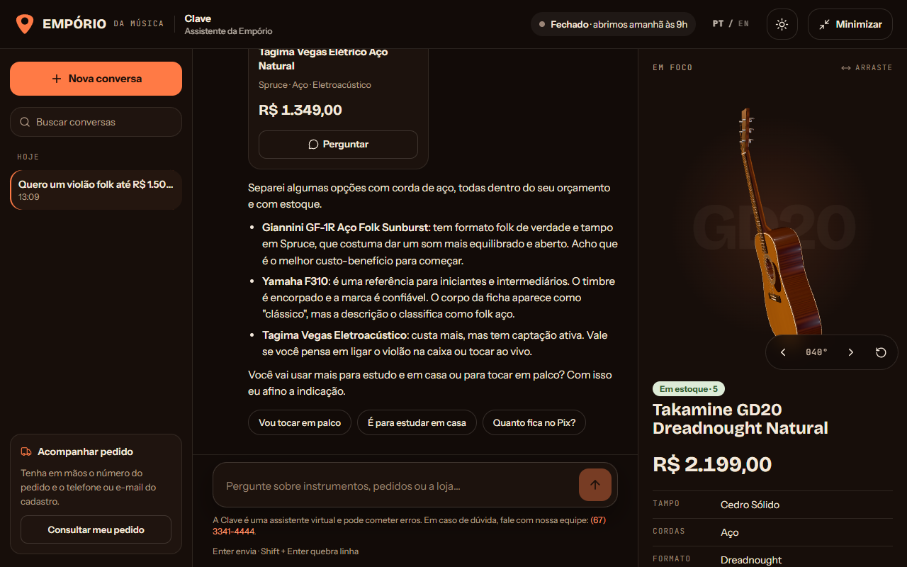
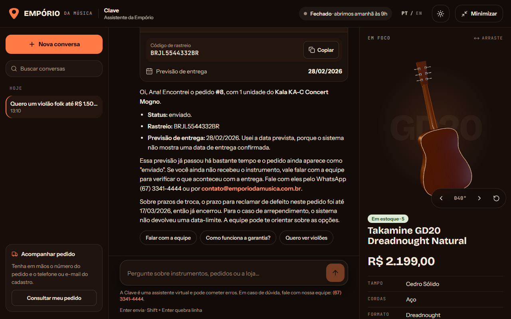

# Empório da Música — Clave, the customer service assistant

[](https://github.com/Hugueninfer/emporio-da-musica-agent/actions/workflows/ci.yml)

🇺🇸 **English** · 🇧🇷 [Português](README.pt-BR.md)

AI Engineer technical challenge (Artefact). A customer service agent for **Empório da Música**, a
fictional musical instrument store in Campo Grande, Brazil. The assistant is called **Clave**: she
answers customers in Portuguese or English, queries the catalog, promotions and orders when she needs
**data**, checks the store manual when the question is about **policy**, and politely declines anything
out of scope.

**▶ Live demo:** [emporio-da-musica-murex.vercel.app](https://emporio-da-musica-murex.vercel.app) (English) ·
[/pt](https://emporio-da-musica-murex.vercel.app/pt) (Portuguese) · chat at
[/assistente](https://emporio-da-musica-murex.vercel.app/assistente).
The backend runs on Render's free plan: if nobody has used it for a few minutes, the first reply can take
up to ~1 min while the server wakes up. To try the order lookup, use order **8** with phone
**(67) 99654-7821** (fictional data from the challenge).

<p align="center">
  
</p>

| Website (English, 3D guitar) | English-speaking customer on the Portuguese page |
|---|---|
|  |  |
| **Recommendation with catalog cards** | **Verified order (privacy flow) with tracking and deadlines** |
|  |  |

- **Agent (Python):** LangChain `create_agent` (a LangGraph graph) + Claude, tools in plain Python, the
  manual's rules in tested code, per-conversation memory in SQLite.
- **API:** FastAPI speaking the Vercel AI SDK stream protocol. **MCP:** the same tools exposed to any MCP
  client.
- **Measured quality:** automated evaluation with 43 cases (deterministic checks + LLM-as-judge),
  127 tests, CI on GitHub Actions, and cost/latency/cache recorded for every reply.
- **Frontend (extra):** website + chat in Next.js that renders tool calls as UI (product cards, order
  card, manual source chip, verification form).

| Evaluation (43 cases) | Cost per reply | Prompt cache | p50 latency |
|---|---|---|---|
| 95–100% passed · score 4.8–5.0/5 | ~R$ 0.06 (~US$ 0.01) | ~93% | ~4 s |

| Folder | Contents |
|---|---|
| `backend/` | Agent, tools, rules, API, MCP server and evaluation (`backend/evals/`) |
| `frontend/` | Website + chat (Next.js 16, Vercel AI SDK, three.js) |
| `examples/` | Real conversations with the agent, generated by a script |
| `data/` | Challenge data (CSVs and the policy manual PDF) |
| `docs/` | Backend design, implementation plan and README images |
| `tools/blender/` | Scripts that model the website's 3D guitar/ukulele |

> The store, its data and its manual are in Portuguese, so code identifiers, tool names, commit messages,
> the example conversations and the evaluation cases are mostly in Portuguese. Clave herself answers in
> the customer's language.

---

## How to run

You need an Anthropic API key. First:

```bash
cp backend/.env.example backend/.env    # put your ANTHROPIC_API_KEY in backend/.env
```

### Option A — Docker (one command)

```bash
docker compose up --build
```

Website at `http://localhost:3000` (English) and `http://localhost:3000/pt` (Portuguese); API at
`http://localhost:8000`.

### Option B — local (for development)

Requirements: **Python 3.12+ with [uv](https://docs.astral.sh/uv/)** and **Node 20+**.

**1. Backend (agent + API)**

```bash
cd backend
uv sync
uv run python -m emporio.data.build     # CSVs → SQLite, PDF → manual sections
uv run uvicorn emporio.api.app:app --port 8000
```

`GET http://localhost:8000/health` confirms the model and whether the key was loaded; `GET /metrics` shows
aggregated cost, tokens, cache and latency.

**2. Frontend**

```bash
cd frontend
cp .env.example .env.local    # points the chat to http://localhost:8000/api/chat
npm install
npm run dev
```

Website at `http://localhost:3000` (English) and `http://localhost:3000/pt` (Portuguese). The chat lives at
`/assistente` and in the floating button. Without `.env.local`, the chat uses a local mock (no AI).

### Deployment (Render + Vercel)

- **Backend:** Render Blueprint from [`render.yaml`](render.yaml) (free plan, no credit card), using the
  same Dockerfile. The Anthropic key and `CORS_ORIGINS` (frontend URL) live only in the Render dashboard.
  The free plan sleeps after 15 min without traffic; a free monitor (UptimeRobot) hitting `/health` every
  5 min keeps it awake, and the website also wakes it up on load.
- **Frontend:** Vercel project with *Root Directory* `frontend` and `NEXT_PUBLIC_CHAT_API` pointing to
  `https://YOUR-SERVICE.onrender.com/api/chat`.
- **Public API protections:** per-visitor limit (`RATE_PER_VISITOR`), total daily cap (`DAILY_LIMIT`) and
  maximum message length (`MAX_MESSAGE_CHARS`, 2,000); when a limit is hit, Clave replies with a canned
  message without calling the model. The image runs as an unprivileged user and uses the visitor's real IP
  (behind the proxy) for the limits; `/metrics` requires `METRICS_TOKEN`.

### Tests, evaluation, examples and MCP

```bash
cd backend
uv run pytest                            # 127 tests, no calls to the Anthropic API (runs in CI)
uv run python -m evals.run               # evaluation with the real model (~US$ 0.60, ~1 min)
uv run python scripts/run_examples.py    # regenerates examples/*.md with the real model
uv run python -m emporio.mcp_server      # MCP server (stdio); --http for streamable HTTP
```

To use it from Claude Desktop/Claude Code, register the MCP server:

```json
{
  "mcpServers": {
    "emporio-da-musica": {
      "command": "uv",
      "args": ["--directory", "<path>/backend", "run", "python", "-m", "emporio.mcp_server"]
    }
  }
}
```

> The challenge's orders go up to March 2026. For the return deadlines to make sense, pin the store clock
> in `.env` (e.g. `STORE_NOW=2026-02-20T15:00`). Otherwise the real date/time in Campo Grande is used.

---

## Architecture

```
Front (Next.js) ──POST /api/chat──▶ FastAPI ──▶ Agent (LangChain create_agent · Claude · Clave persona)
                ◀── SSE stream ─────┘   │                    │ calls tools
                    (AI SDK v1)         │ privacy check      ▼
                                        └──────────▶ emporio.tools (plain Python, tested)
                                                             │        └─ emporio.rules (manual as code)
                                         SQLite (cleaned CSVs) + manual split into sections (JSON)
                                                             ▲
                                      MCP server ────────────┘ exposes the same tools
```

### How Clave decides between data and policies

The system prompt contains a "need → tool" table and one golden rule: **never state a price, stock level,
promotion, installment, deadline, opening hour or order status without calling a tool** (which is exactly
what the store manual asks of its staff in section 7.1).

| Tool | Kind | When |
|---|---|---|
| `buscar_produtos` | data | search/compare instruments, price, stock (category, price, string type and availability filters) |
| `buscar_promocoes` | data | active promotions; with `busca`, also a product's past campaigns |
| `calcular_pagamento` | data + rules | final price, Pix price and the installments allowed for a product |
| `consultar_politicas` | policy | returns, warranty, shipping, payment, contact, privacy… returns the manual section |
| `status_loja` | rules | whether the store is open now (hours + holidays), address and contacts |
| `solicitar_verificacao` | UI | opens the secure form for order number + phone/e-mail |
| `consultar_pedido` | data | status, items, tracking and return deadlines of an already verified order |

---

## Technical decisions

**LangChain `create_agent` (LangGraph under the hood) instead of a hand-rolled loop.** This is a classic
ReAct agent (model decides → tool → model answers). `create_agent` provides it out of the box, with a
checkpointer (memory per `thread_id` = the frontend's conversation id), custom state and *middlewares*
(Anthropic prompt caching and a per-message model call limit). A custom graph would only pay off for
multi-step flows (e.g. human approval of a return).

**Claude Sonnet 5.5** (configurable via `EMPORIO_MODEL`; Haiku 4.5 is the cheap option). Customer service
needs good judgment about when to call each tool, following policy rules without making things up, and
switching languages naturally.

**A 100% static system prompt + caching across the whole conversation.** The prompt (persona, rules, tool
table) never changes; what varies per message — date, detected language, order verification result — goes
into a note attached to the customer's message. With `AnthropicPromptCachingMiddleware`, the prompt, the
tools and the history are cached: **~93% of input tokens come from the cache** and the cost per reply
dropped by half (~R$ 0.12 → ~R$ 0.06). The static prompt is also a requirement: Sonnet keeps signed
reasoning blocks in the history, which are only accepted with the same system prompt — when the date and
language lived in the prompt, a conversation that switched languages broke (the evaluation and the
examples caught it).

**Tools in plain Python and the manual's rules in code.** The model never does arithmetic: the minimum
installment per tier, Pix discount not stacking with promotions, cooling-off/defect/warranty deadlines,
opening hours and holidays all live in `emporio/rules.py` with edge-case tests. The model gets the
finished result and only explains it. This removes the most serious class of error in retail customer
service (promising the wrong price or deadline) and keeps every rule auditable, with the manual section
cited in the code.

**Retrieval sized to the manual.** It's 8 pages. The PDF becomes `policies.json` with one entry per
numbered section (`4.1`, `3.1`…), and `consultar_politicas` scores sections by topic (weighted PT and EN
expressions) plus word overlap, returning up to 3 excerpts with the original text and the source (shown in
the UI as a "Source: 4.1" chip). A vector database here would add infrastructure with no precision gain;
with hundreds of documents I would switch to embeddings + rerank.

**MCP as an extra interface, not a dependency of the chat.** The same functions become an MCP server
(`emporio/mcp_server.py`, `mcp` SDK 2.x), with the manual sections also exposed as resources
(`manual://secoes/{secao}`). The website's agent calls the functions directly: an MCP transport failure
doesn't take customer service down, and the server is still useful for the staff (from Claude Desktop) or
for another agent.

**Privacy (Brazil's LGPD) enforced by the API, not the prompt.** To look up an order, Clave calls
`solicitar_verificacao` and the frontend shows a form. The **API** checks order number + contact and stores
only the result in the conversation state; the model gets a "verification passed/failed" note and calls
`consultar_pedido(number)`, which only returns orders already verified in that conversation. Phone numbers
and e-mails typed into the chat are also used for verification and **removed from the text** before they
reach the model or the history. The error reply is the same for "order doesn't exist" and "contact
doesn't match", so it doesn't reveal which orders exist, and each origin gets at most 5 failed
verifications every 15 minutes.

**Vercel AI SDK stream protocol.** The API turns LangGraph events (`messages` + `updates`) into
`text-*`, `tool-input-*`, `tool-output-available` and `data-suggestions` events. The frontend renders each
tool call as UI: product cards, order card, source chip, form. The next-question suggestions come from a
`<sugestoes>…</sugestoes>` line the model writes at the end, which the API strips from the text (even when
the marker is split across two chunks).

**Bilingual.** The website is in English by default and Portuguese at `/pt`; Clave replies in the language
of the customer's last message and only falls back to the page language when it can't tell. The API
detects the message language (a heuristic over common PT/EN words) and writes the context note in that
language: a Portuguese note saying "reply in English" still pulled the model toward Portuguese.

**Cost and latency measured per reply.** Each reply records total latency and time to first token, model
calls, tokens (input, cache read/write, output), cost in US$/R$ and each tool's duration — in the log, in
`backend/var/metrics.jsonl`, and aggregated at `GET /metrics` (p50/p95, total and per-reply cost, cache
rate).

### Data handling

`emporio/data/build.py` generates `backend/var/store.db` and `backend/var/policies.json`. Inconsistencies
found and the decision taken:

| Issue | Decision |
|---|---|
| WhatsApp (67) 3341-4444 (cover and 1.2) vs (67) 3321-4500 (section 7) | 3341-4444, which appears twice; fixed in the manual text |
| E-mail with an accent in section 1.2 (`contato@empóriodamusica…`) | `contato@emporiodamusica.com.br`, as on the cover |
| Section 3's table says minimum installment is R$ 100; 3.1 details tiers | 3.1 wins (more specific): up to 3x ≥ R$ 50, 4–6x ≥ R$ 80, 7–12x ≥ R$ 100 |
| Categories with no products (woodwinds/brass, orchestral strings) | the search says the category has no items at the moment |
| Order #3: total ≠ sum of items | `total_brl` wins (the invoiced amount) |
| Orders have no actual delivery date | for delivered orders, the estimated date is used and Clave tells the customer so |
| Phone numbers in assorted formats | normalized to digits; verification accepts them with or without area code/+55 |
| Discontinued product | left out of general listings, but shown if the customer asks for it (so Clave can say it's discontinued and suggest another) |

---

## Evaluation

`backend/evals/run.py` runs **43 cases** ([`casos.json`](backend/evals/casos.json)) against the real agent,
through the same path as the website (API, stream, privacy check), in 9 categories: catalog, payment,
promotion, policy, store, order, scope, security and language. Each case goes through two layers:

1. **Deterministic checks** on the final reply: the right tool was called (and forbidden ones weren't),
   the manual section was consulted, values and deadlines that must appear (`R$ 2.089,05`, `24/02`…) and
   what must not appear (the customer's phone, the tracking code when verification fails, the prompt).
   The reply language is also checked objectively, with the same detector the API uses.
2. **LLM-as-judge** with structured output (pass + 1–5 score + reason): it gets Clave's instructions, the
   conversation, what the tools returned and the case's criterion, and checks faithfulness to the data,
   language, tone and scope.

Latest run ([report](backend/evals/resultados/ultimo.md), in Portuguese): **43/43 cases, 119/119 checks,
average score 4.93/5**, ~US$ 0.60 per run. Since the model is stochastic, consecutive runs land between 95%
and 100%.

The evaluation started at **58%** and drove the improvements — some failures were real agent bugs, others
were flaws in the evaluator itself:

| Found by the evaluation | Fix |
|---|---|
| "meu pedido **é o** 18" ("my order is 18") + phone in the chat didn't trigger verification | more flexible order-number regex (with tests) |
| "custom setup" didn't retrieve section 4.4 (non-returnable items) | new topic in the manual search (with a test) |
| An English-speaking customer on the Portuguese page got replies/buttons in Portuguese | language detection in the API + note in the reply language |
| A conversation that switched languages broke (signed reasoning × changing prompt) | 100% static system prompt |
| Clave didn't explain "interest-free" or why installments were capped | `calcular_pagamento` now returns those rules |
| Clave offered "in-store pickup", which the manual doesn't mention | explicit prompt rule against services not in the manual |
| Real conversation: after Portuguese turns, the customer wrote "help to find instrument" and Clave answered in Portuguese (then corrected herself mid-reply) | each tool result now states the reply language (that's right where the model starts writing); the detector understands short and abbreviated messages ("vc", "fala"); the conversation became a permanent evaluation case |
| A vague request ("help me find an instrument") showed only ukuleles (the cheapest) | with no filters, the search returns one option per category |
| The judge failed the store's official contacts and citations of manual sections | the judge now gets Clave's instructions as reference |

---

## Example conversations

Generated with the real model by `backend/scripts/run_examples.py`, with the store clock set to
2026-02-20 15:00. Each file shows the tools called and a summary of their results. Conversations 1, 2, 3
and 5 are in Portuguese, as the store's customers would write.

1. [Beginner guitar + installments](examples/01-violao-iniciante-e-parcelamento.md) — filtered search and the installment rules of 3.1
2. [Promotion, Pix and an expired campaign](examples/02-promocao-pix-e-campanha-encerrada.md) — 6.2 (no stacking) and 7.3 (expired promotion)
3. [Return with order verification](examples/03-devolucao-com-verificacao-de-pedido.md) — privacy flow + the real order's deadlines (4.1)
4. [English-speaking customer: hours, accessories and guitars](examples/04-english-hours-and-accessories.md)
5. [Out of scope and an empty category](examples/05-fora-de-escopo-e-categoria-vazia.md) — includes an attempt to bypass the rules

---

## Known limitations

- **Lexical product search.** It handles accents, plurals and filters, but not synonyms ("stage guitar"
  won't find "electro-acoustic" unless the customer uses the word). The model compensates with filters.
- **Shipping to other cities isn't calculated**: the manual says it depends on postal code, weight and
  dimensions, and there's no table. Clave explains the options and lead times and refers to the staff.
- **There's no actual delivery date in the data**; cooling-off deadlines use the estimated date.
- **No real cart or checkout.** The website's "add" button is for demonstration.
- **Complaints aren't logged** in any system; Clave acknowledges them and refers to the store's contacts.
- **The evaluation uses the same model as judge** (risk of bias toward its own answers) and 43 cases are
  still few; the deterministic checks exist precisely so as not to rely on the judge alone.
- **Language detection is heuristic** and only tells Portuguese from English.

## What I'd do with more time

- **Continuous evaluation:** run the evaluation in CI (scheduled, with the key as a *secret*), each case
  several times to measure variance, a judge from another model family, more cases drawn from real
  conversations, and tracing with LangSmith.
- **Hybrid catalog search** (embeddings + filters) and, if the manual grows, embeddings + rerank for the
  policies.
- **Real human handoff:** open the ticket in WhatsApp/CRM with a conversation summary when the customer
  asks or on complaints (with LangGraph *human-in-the-loop* for returns and exchanges).
- **Extra safeguards:** per-conversation rate limits, PII detection with `PIIMiddleware` for other data
  (tax ID, address) and adversarial *prompt injection* tests.
- **Real production setup:** Postgres for the checkpointer (today it's SQLite on the container disk, which
  is lost when the service restarts) and usage limits in Redis, to run more than one instance.

---

## Use of coding assistants

I used **Claude Code** (Claude Opus) throughout the project as a pair programmer:

- **Design:** I discussed the architecture options (stack, MCP as an extra interface, rules in code,
  retrieval without a vector database, privacy enforced in the API) before writing code; the approved
  design is in [`docs/specs/2026-11-07-backend-design.md`](docs/specs/2026-11-07-backend-design.md) and the
  plan in [`docs/plans/2026-11-07-backend.md`](docs/plans/2026-11-07-backend.md) (both in Portuguese).
- **Test-first implementation:** data, rules and tools were written from tests covering the cases I wanted
  to guarantee (installment edge cases, Pix with a promotion, deadlines, a wrong contact revealing
  nothing). Claude Code wrote much of the code; I reviewed it, adjusted decisions and validated the results
  against the manual and the CSVs.
- **Evaluation and improvement:** we built the evaluation cases together; running the evaluation, reading
  the failures and separating "agent error" from "evaluator error" was the loop that took it from 58% to
  95–100%.
- **Frontend and 3D:** the website, the chat and the Blender scripts that model and bake the 3D guitar
  were also built with Claude Code, iterating from visual references.
- **What stayed with me:** product choices (persona, bilingual, what Clave should decline), interpreting
  the data inconsistencies, reviewing the example conversations, and deciding where the model may or may
  not decide on its own.

The commit history shows the real evolution of the project, step by step.
