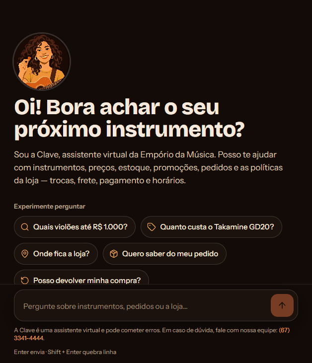
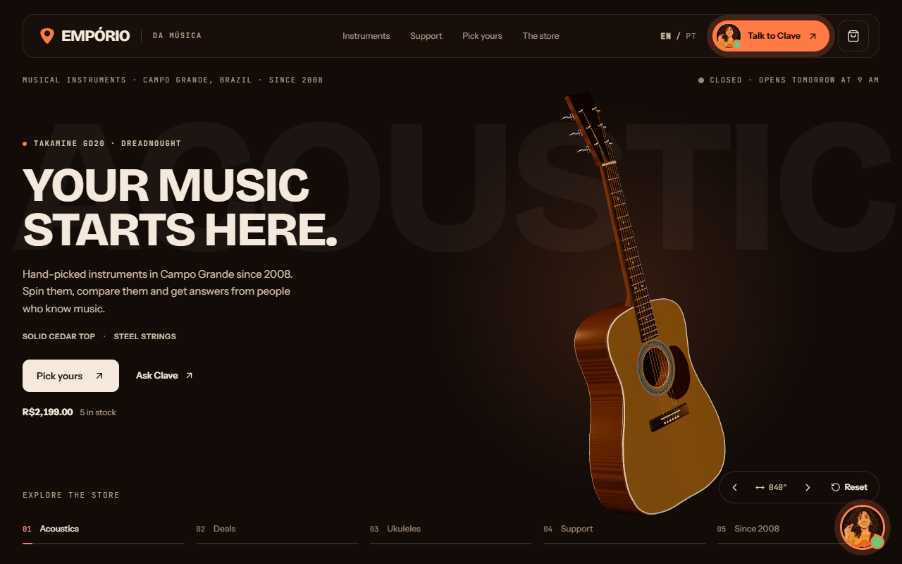
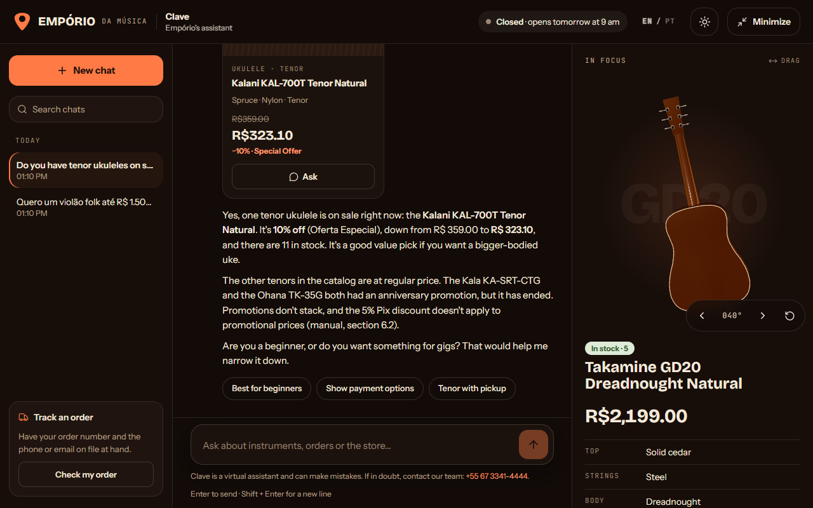
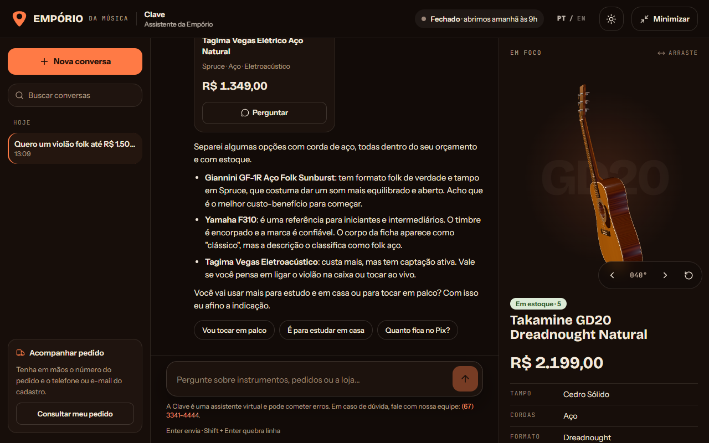
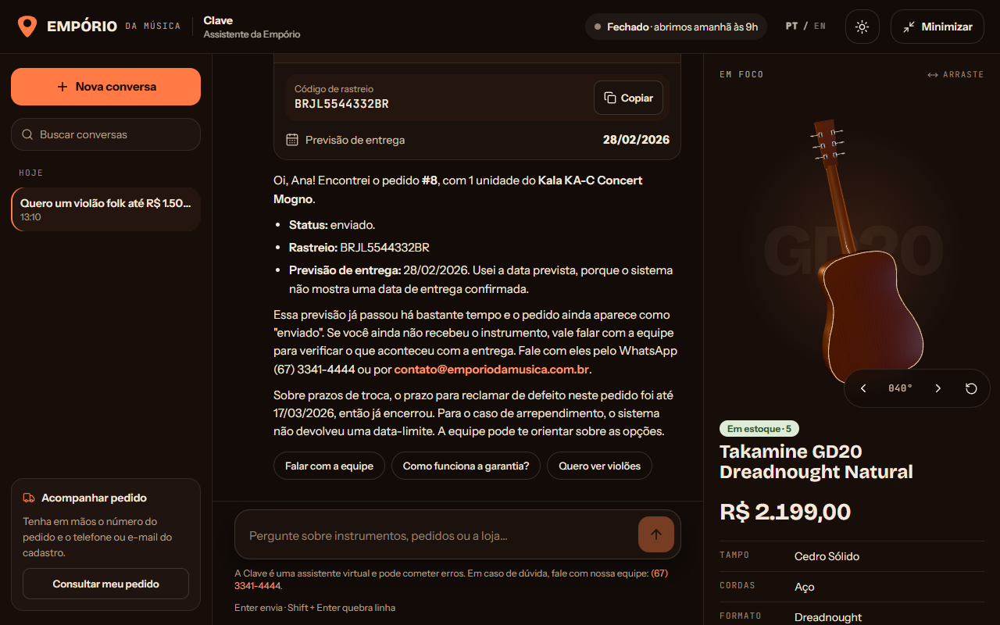

# Empório da Música — Clave, a assistente de atendimento

[](https://github.com/Hugueninfer/emporio-da-musica-agent/actions/workflows/ci.yml)

🇺🇸 [English](README.md) · 🇧🇷 **Português**

Desafio técnico de AI Engineer (Artefact). Um agente de atendimento para a **Empório da Música**, loja
fictícia de instrumentos musicais em Campo Grande/MS. A assistente se chama **Clave**: responde
clientes em português ou inglês, consulta catálogo, promoções e pedidos quando precisa de **dados**,
consulta o manual quando a dúvida é de **política**, e recusa com educação o que foge do escopo.

**▶ Demo online:** [emporio-da-musica-murex.vercel.app](https://emporio-da-musica-murex.vercel.app) (inglês) ·
[/pt](https://emporio-da-musica-murex.vercel.app/pt) (português) · chat em
[/pt/assistente](https://emporio-da-musica-murex.vercel.app/pt/assistente).
Backend no plano gratuito do Render: se ninguém usou nos últimos minutos, a primeira resposta pode levar
até ~1 min enquanto o servidor acorda. Para testar a consulta de pedido, use o pedido **8** com o telefone
**(67) 99654-7821** (dados fictícios do desafio).

<p align="center">
  
</p>

| Site (inglês, violão 3D) | Cliente em inglês numa página em português |
|---|---|
|  |  |
| **Recomendação com cards do catálogo** | **Pedido verificado (LGPD) com rastreio e prazos** |
|  |  |

- **Agente (Python):** LangChain `create_agent` (grafo LangGraph) + Claude, ferramentas em Python puro,
  regras do manual em código testado, memória por conversa em SQLite.
- **API:** FastAPI falando o protocolo de stream do Vercel AI SDK. **MCP:** as mesmas ferramentas
  expostas para qualquer cliente MCP.
- **Qualidade medida:** avaliação automática com 43 casos (checagens determinísticas + LLM-as-judge),
  127 testes, CI no GitHub Actions e custo/latência/cache registrados por resposta.
- **Front (extra):** site + chat em Next.js que renderiza as chamadas de ferramenta como interface
  (cards de produto, card do pedido, fonte do manual, formulário de verificação).

| Avaliação (43 casos) | Custo por resposta | Cache do prompt | Latência p50 |
|---|---|---|---|
| 95–100% aprovados · nota 4,8–5,0/5 | ~R$ 0,06 | ~93% | ~4 s |

| Pasta | Conteúdo |
|---|---|
| `backend/` | Agente, ferramentas, regras, API, servidor MCP e avaliação (`backend/evals/`) |
| `frontend/` | Site + chat (Next.js 16, Vercel AI SDK, three.js) |
| `examples/` | Conversas reais com o agente, geradas por script |
| `data/` | Dados do desafio (CSVs e manual em PDF) |
| `docs/` | Desenho do backend, plano de implementação e imagens do README |
| `tools/blender/` | Scripts que modelam o violão/ukulele 3D do site |

---

## Como rodar

Você precisa de uma chave da API da Anthropic. Primeiro:

```bash
cp backend/.env.example backend/.env    # coloque sua ANTHROPIC_API_KEY no backend/.env
```

### Opção A — Docker (um comando)

```bash
docker compose up --build
```

Site em `http://localhost:3000` (inglês) e `http://localhost:3000/pt` (português); API em
`http://localhost:8000`.

### Opção B — local (para desenvolver)

Pré-requisitos: **Python 3.12+ com [uv](https://docs.astral.sh/uv/)** e **Node 20+**.

**1. Backend (agente + API)**

```bash
cd backend
uv sync
uv run python -m emporio.data.build     # CSVs → SQLite, PDF → seções do manual
uv run uvicorn emporio.api.app:app --port 8000
```

`GET http://localhost:8000/health` confirma o modelo e se a chave foi lida; `GET /metrics` mostra custo,
tokens, cache e latência agregados.

**2. Frontend**

```bash
cd frontend
cp .env.example .env.local    # aponta o chat para http://localhost:8000/api/chat
npm install
npm run dev
```

Site em `http://localhost:3000` (inglês) e `http://localhost:3000/pt` (português). O chat fica em
`/assistente` e no botão flutuante. Sem o `.env.local`, o chat usa um mock local (sem IA).

### Publicação (Render + Vercel)

- **Backend:** Blueprint do Render a partir do [`render.yaml`](render.yaml) (plano gratuito, sem cartão),
  usando o mesmo Dockerfile. A chave da Anthropic e `CORS_ORIGINS` (URL do front) ficam só no painel.
  O plano gratuito dorme após 15 min sem uso; um monitor gratuito (UptimeRobot) chamando `/health` a
  cada 5 min o mantém acordado, e o site também o acorda ao abrir.
- **Front:** projeto na Vercel com *Root Directory* `frontend` e `NEXT_PUBLIC_CHAT_API` apontando para
  `https://SEU-SERVICO.onrender.com/api/chat`.
- **Proteções da API pública:** limite por visitante (`RATE_PER_VISITOR`), teto diário total
  (`DAILY_LIMIT`) e tamanho máximo da mensagem (`MAX_MESSAGE_CHARS`, 2.000); ao estourar, a Clave
  responde com uma mensagem pronta sem chamar o modelo. A imagem roda como usuário sem privilégios e usa
  o IP real do visitante (atrás do proxy) para os limites; `/metrics` exige `METRICS_TOKEN`.

### Testes, avaliação, exemplos e MCP

```bash
cd backend
uv run pytest                            # 127 testes, sem chamar a API da Anthropic (roda no CI)
uv run python -m evals.run               # avaliação com o modelo real (~R$ 2,50, ~1 min)
uv run python scripts/run_examples.py    # regenera examples/*.md com o modelo real
uv run python -m emporio.mcp_server      # servidor MCP (stdio); --http para streamable HTTP
```

Para usar no Claude Desktop/Claude Code, registre o servidor MCP:

```json
{
  "mcpServers": {
    "emporio-da-musica": {
      "command": "uv",
      "args": ["--directory", "<caminho>/backend", "run", "python", "-m", "emporio.mcp_server"]
    }
  }
}
```

> Os pedidos do desafio vão até março/2026. Para os prazos de troca fazerem sentido, fixe o relógio da
> loja no `.env` (ex.: `STORE_NOW=2026-02-20T15:00`). Sem isso vale a data/hora real de Campo Grande.

---

## Arquitetura

```
Front (Next.js) ──POST /api/chat──▶ FastAPI ──▶ Agente (LangChain create_agent · Claude · persona Clave)
                ◀── stream SSE ─────┘   │                    │ chama ferramentas
                    (AI SDK v1)         │ verificação LGPD   ▼
                                        └──────────▶ emporio.tools (Python puro, testadas)
                                                             │        └─ emporio.rules (manual em código)
                                         SQLite (CSVs tratados) + manual em seções (JSON)
                                                             ▲
                                      Servidor MCP ──────────┘ expõe as mesmas ferramentas
```

### Como a Clave decide entre dados e políticas

O prompt de sistema traz uma tabela "necessidade → ferramenta" e uma regra de ouro: **nunca informar
preço, estoque, promoção, parcela, prazo, horário ou status de pedido sem consultar uma ferramenta**
(é o que o próprio manual pede na seção 7.1).

| Ferramenta | Tipo | Quando |
|---|---|---|
| `buscar_produtos` | dados | procurar/comparar instrumentos, preço, estoque (filtros de categoria, preço, corda, disponibilidade) |
| `buscar_promocoes` | dados | promoções ativas; com `busca`, também as campanhas já encerradas de um produto |
| `calcular_pagamento` | dados + regras | preço final, Pix e parcelas permitidas para um produto |
| `consultar_politicas` | políticas | trocas, garantia, frete, pagamento, contato, LGPD… devolve a seção do manual |
| `status_loja` | regras | se a loja está aberta agora (horário + feriados), endereço e contatos |
| `solicitar_verificacao` | UI | abre o formulário seguro de número do pedido + telefone/e-mail |
| `consultar_pedido` | dados | status, itens, rastreio e prazos de troca de um pedido já verificado |

---

## Decisões técnicas

**LangChain `create_agent` (LangGraph por baixo) em vez de um loop próprio.** O problema é um agente
ReAct clássico (modelo decide → ferramenta → modelo responde). O `create_agent` dá isso pronto, com
checkpointer (memória por `thread_id` = id da conversa do front), estado customizado e *middlewares*
(cache de prompt da Anthropic e limite de chamadas ao modelo por mensagem). Um grafo próprio só valeria
com fluxos de várias etapas (ex.: aprovação humana de troca).

**Claude Sonnet 5.5** (configurável por `EMPORIO_MODEL`; Haiku 4.5 é a opção barata). O atendimento
pede bom julgamento de quando chamar cada ferramenta, seguir regras de política sem inventar e trocar de
idioma com naturalidade.

**Prompt de sistema 100% fixo + cache em toda a conversa.** O prompt (persona, regras, tabela de
ferramentas) nunca muda; o que varia a cada mensagem — data, idioma detectado, resultado da verificação
de pedido — vai numa nota anexada à mensagem do cliente. Com o `AnthropicPromptCachingMiddleware`, o
prompt, as ferramentas e o histórico entram no cache: **~93% dos tokens de entrada vêm do cache** e o
custo por resposta caiu pela metade (~R$ 0,12 → ~R$ 0,06). O prompt fixo também é uma exigência: o
Sonnet guarda blocos de raciocínio assinados no histórico, que só são aceitos com o mesmo prompt de
sistema — quando a data/idioma ficavam no prompt, uma conversa que trocava de idioma quebrava (a
avaliação e os exemplos pegaram isso).

**Ferramentas em Python puro e regras do manual em código.** Contas não ficam com o modelo:
parcela mínima por faixa, Pix que não acumula com promoção, prazos de arrependimento/defeito/garantia,
horário e feriados estão em `emporio/rules.py` com testes de borda. O modelo recebe o resultado pronto
e só explica. Isso elimina a classe de erro mais grave num atendimento de loja (prometer preço ou prazo
errado) e deixa cada regra auditável com a seção do manual citada no código.

**Retrieval proporcional ao tamanho do manual.** São 8 páginas. O PDF vira `policies.json` com uma
entrada por seção numerada (`4.1`, `3.1`…), e `consultar_politicas` pontua as seções por assunto
(expressões em PT e EN com pesos) + sobreposição de palavras, devolvendo até 3 trechos com o texto
original e a fonte (que a UI mostra como chip "Fonte: 4.1"). Um banco vetorial aqui seria mais
infraestrutura sem ganho de precisão; com centenas de documentos eu trocaria por embeddings + rerank.

**MCP como interface adicional, não como dependência do chat.** As mesmas funções viram um servidor
MCP (`emporio/mcp_server.py`, SDK `mcp` 2.x), com as seções do manual também como recurso
(`manual://secoes/{secao}`). O agente do site chama as funções direto: uma falha no transporte MCP não
derruba o atendimento, e o servidor continua útil para a equipe usar a partir do Claude Desktop ou para
outro agente.

**Privacidade (LGPD) na API, não no prompt.** Para ver um pedido, a Clave chama `solicitar_verificacao`
e o front mostra um formulário. A **API** confere número + contato e guarda só o resultado no estado da
conversa; o modelo recebe uma nota "verificação aprovada/falhou" e chama `consultar_pedido(numero)`,
que só devolve pedidos já verificados naquela conversa. Telefone e e-mail digitados no chat também são
usados para verificar e **apagados do texto** antes de chegar ao modelo e ao histórico. A resposta de
erro é a mesma para "pedido não existe" e "contato não confere", para não revelar quais pedidos existem,
e cada origem tem no máximo 5 verificações erradas a cada 15 minutos.

**Stream no protocolo do Vercel AI SDK.** A API converte os eventos do LangGraph (`messages` +
`updates`) em eventos `text-*`, `tool-input-*`, `tool-output-available` e `data-suggestions`. O front
renderiza cada chamada de ferramenta como interface: cards de produto, card do pedido, chip da fonte,
formulário. As sugestões de próxima pergunta vêm de uma linha `<sugestoes>…</sugestoes>` que o modelo
escreve no fim e a API tira do texto (mesmo quando o marcador chega quebrado entre dois pedaços).

**Bilíngue.** O site é em inglês por padrão e português em `/pt`; a Clave responde no idioma da última
mensagem do cliente e usa o idioma da página só quando não dá para saber. A API detecta o idioma da
mensagem (heurística de palavras comuns em PT/EN) e escreve a nota de contexto nesse idioma: uma nota em
português pedindo "responda em inglês" ainda puxava o modelo para o português.

**Custo e latência medidos por resposta.** Cada resposta registra latência total e até o primeiro token,
chamadas ao modelo, tokens (entrada, cache lido/gravado, saída), custo em US$/R$ e o tempo de cada
ferramenta — no log, em `backend/var/metrics.jsonl`, no `messageMetadata` do stream e agregado em
`GET /metrics` (p50/p95, custo total e por resposta, taxa de cache).

### Tratamento dos dados

`emporio/data/build.py` gera `backend/var/store.db` e `backend/var/policies.json`. Inconsistências
encontradas e a decisão tomada:

| Problema | Decisão |
|---|---|
| WhatsApp (67) 3341-4444 (capa e 1.2) × (67) 3321-4500 (seção 7) | 3341-4444, que aparece duas vezes; corrigido no texto do manual |
| E-mail com acento na seção 1.2 (`contato@empóriodamusica…`) | `contato@emporiodamusica.com.br`, como na capa |
| Tabela da seção 3 diz parcela mínima de R$ 100; a 3.1 detalha faixas | vale a 3.1 (mais específica): até 3x ≥ R$ 50, 4–6x ≥ R$ 80, 7–12x ≥ R$ 100 |
| Categorias sem produtos (sopros, cordas orquestrais) | a busca avisa que não há itens na categoria no momento |
| Pedido #3: total ≠ soma dos itens | vale o `total_brl` (valor faturado) |
| Pedidos não têm data real de entrega | para pedidos entregues, uso a data prevista e a Clave avisa isso ao cliente |
| Telefones em formatos variados | normalizados para dígitos; a verificação aceita com ou sem DDD/+55 |
| Produto descontinuado | sai das listagens gerais, mas aparece se o cliente procurar por ele (para a Clave dizer que saiu de linha e sugerir outro) |

---

## Avaliação

`backend/evals/run.py` roda **43 casos** ([`casos.json`](backend/evals/casos.json)) contra o agente
real, pelo mesmo caminho do site (API, stream, verificação LGPD), em 9 categorias: catálogo, pagamento,
promoção, política, loja, pedido, escopo, segurança e idioma. Cada caso passa por duas camadas:

1. **Checagens determinísticas** na resposta final: ferramenta certa chamada (e as proibidas não),
   seção do manual consultada, valores e prazos que precisam aparecer (`R$ 2.089,05`, `24/02`…) e o
   que não pode aparecer (telefone do cliente, código de rastreio quando a verificação falha, o prompt).
   O idioma da resposta também é checado de forma objetiva, com o mesmo detector da API.
2. **LLM-as-judge** com saída estruturada (aprovado + nota 1–5 + motivo): recebe as instruções da Clave,
   a conversa, o que as ferramentas devolveram e o critério do caso; checa fidelidade aos dados, idioma,
   tom e escopo.

Resultado mais recente ([relatório](backend/evals/resultados/ultimo.md)): **43/43 casos, 119/119
checagens, nota média 4,93/5**, custo da rodada ~R$ 3,30. Como o modelo é estocástico, rodadas
seguidas ficam entre 95% e 100%.

A avaliação começou em **58%** e foi o que guiou as melhorias — parte eram falhas reais do agente, parte
eram falhas do próprio avaliador:

| Encontrado pela avaliação | Correção |
|---|---|
| "meu pedido **é o** 18" + telefone no chat não disparava a verificação | regex de número de pedido mais flexível (com testes) |
| "setup personalizado" não recuperava a seção 4.4 (itens não elegíveis) | assunto novo na busca do manual (com teste) |
| Cliente em inglês numa página em português recebia resposta/botões em português | detecção de idioma na API + nota no idioma da resposta |
| Conversa que trocava de idioma quebrava (raciocínio assinado × prompt variável) | prompt de sistema 100% fixo |
| A Clave não explicava "sem juros" nem o porquê do limite de parcelas | `calcular_pagamento` passou a devolver essas regras |
| A Clave ofereceu "retirada na loja", que o manual não cita | regra explícita no prompt contra serviços fora do manual |
| Conversa real: depois de turnos em português, o cliente escreveu "help to find instrument" e a Clave respondeu em português (e se corrigiu no meio) | o resultado de cada ferramenta passa a dizer o idioma da resposta (é logo depois dele que o modelo escreve); detector de idioma entende mensagens curtas e abreviadas ("vc", "fala"); a conversa virou caso fixo da avaliação |
| Pedido vago ("me ajuda a achar um instrumento") mostrava só ukuleles (os mais baratos) | sem filtros, a busca devolve uma opção de cada categoria |
| Juiz reprovava contatos oficiais da loja e a citação da seção do manual | juiz passou a receber as instruções da Clave como referência |

---

## Exemplos de conversa

Gerados com o modelo real por `backend/scripts/run_examples.py`, com o relógio da loja em
20/02/2026 15:00. Cada arquivo mostra as ferramentas chamadas e o resultado resumido.

1. [Violão para iniciante + parcelamento](examples/01-violao-iniciante-e-parcelamento.md) — busca com filtros e regras de parcela da 3.1
2. [Promoção, Pix e campanha encerrada](examples/02-promocao-pix-e-campanha-encerrada.md) — 6.2 (não acumula) e 7.3 (promoção expirada)
3. [Devolução com verificação de pedido](examples/03-devolucao-com-verificacao-de-pedido.md) — LGPD + prazos do pedido real (4.1)
4. [Cliente em inglês: horário, acessórios e guitarras](examples/04-english-hours-and-accessories.md)
5. [Fora de escopo e categoria vazia](examples/05-fora-de-escopo-e-categoria-vazia.md) — inclui tentativa de burlar as regras

---

## Limitações conhecidas

- **Busca de produtos léxica.** Entende acento, plural e filtros, mas não sinônimos ("violão de show"
  não encontra "eletroacústico" se o cliente não usar a palavra). O modelo compensa usando filtros.
- **Frete para outras cidades não é calculado**: o manual diz que depende de CEP, peso e dimensões, e
  não há tabela. A Clave explica as modalidades e prazos e encaminha para a equipe.
- **Data de entrega real não existe nos dados**; prazos de arrependimento usam a data prevista.
- **Sem carrinho nem checkout reais.** O botão "adicionar" do site é demonstrativo.
- **Reclamações não são registradas** em sistema; a Clave acolhe e encaminha para os contatos da loja.
- **A avaliação usa o mesmo modelo como juiz** (risco de viés a favor das próprias respostas) e 43 casos
  ainda são poucos; as checagens determinísticas existem justamente para não depender só do juiz.
- **Detecção de idioma é heurística** e só distingue português e inglês.

## O que eu faria com mais tempo

- **Avaliação contínua:** rodar a avaliação no CI (agendada, com a chave como *secret*), cada caso
  algumas vezes para medir variância, juiz de outra família de modelo, mais casos tirados de conversas
  reais e tracing com LangSmith.
- **Busca híbrida no catálogo** (embeddings + filtros) e, se o manual crescer, embeddings + rerank nas
  políticas.
- **Handoff humano de verdade:** criar o atendimento no WhatsApp/CRM com o resumo da conversa quando o
  cliente pedir ou em reclamações (com *human-in-the-loop* do LangGraph para trocas e devoluções).
- **Proteções adicionais:** limite de taxa por conversa, detecção de PII com o `PIIMiddleware` para
  outros dados (CPF, endereço) e testes adversariais de *prompt injection*.
- **Produção de verdade:** Postgres no checkpointer (hoje SQLite no disco do container, que some quando
  o serviço reinicia) e limites de uso no Redis, para rodar mais de uma instância.

---

## Uso de assistentes de código

Usei o **Claude Code** (Claude Opus) durante todo o projeto, como par de programação:

- **Desenho:** discuti as opções de arquitetura (stack, MCP como interface extra, regras em código,
  retrieval sem banco vetorial, LGPD na API) antes de codar; o desenho aprovado está em
  [`docs/specs/2026-11-07-backend-design.md`](docs/specs/2026-11-07-backend-design.md) e o plano em
  [`docs/plans/2026-11-07-backend.md`](docs/plans/2026-11-07-backend.md).
- **Implementação com testes primeiro:** dados, regras e ferramentas foram escritos a partir de testes
  com os casos que eu queria garantir (bordas de parcela, Pix com promoção, prazos, contato errado não
  revelar nada). O Claude Code escreveu boa parte do código; eu revisei, ajustei decisões e validei os
  resultados contra o manual e os CSVs.
- **Avaliação e melhoria:** montamos juntos os casos de avaliação; rodar a avaliação, ler as falhas e
  separar "erro do agente" de "erro do avaliador" foi o ciclo que levou de 58% para 95–100%.
- **Frontend e 3D:** o site, o chat e os scripts do Blender que modelam e "assam" o violão 3D também
  foram feitos com o Claude Code, iterando a partir de referências visuais.
- **O que ficou comigo:** escolhas de produto (persona, bilíngue, o que a Clave deve recusar),
  interpretação das inconsistências dos dados, revisão das conversas de exemplo e a decisão de onde o
  modelo pode ou não decidir sozinho.

O histórico de commits mostra a evolução real do projeto, etapa por etapa.
